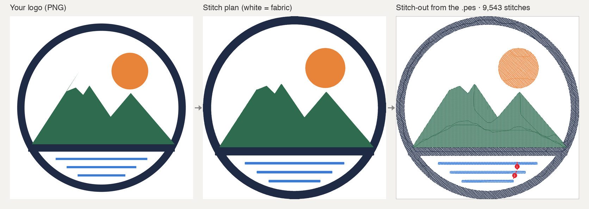
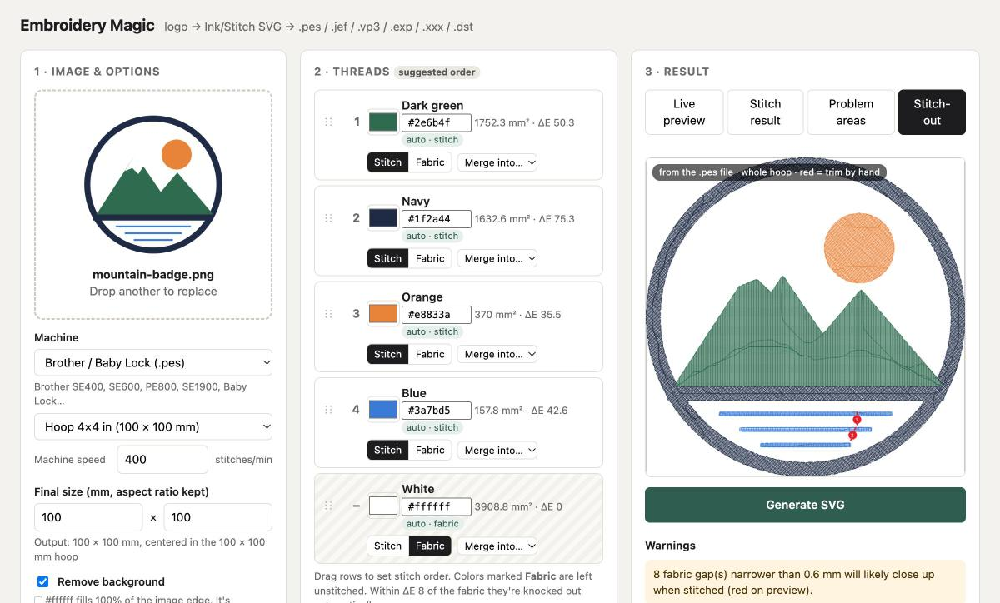

# Embroidery Magic

[](https://github.com/9valleb9/embroidery-magic/actions/workflows/test.yml)

**Turn a logo into a machine embroidery file — free, open source, runs on your computer.**

Drop in a PNG, JPG or SVG logo, pick your machine, hoop and fabric, and get a stitch file you can put on a USB stick: **.pes** (Brother, Baby Lock), **.jef** (Janome, Elna), **.vp3** (Husqvarna Viking, Pfaff), **.exp** (Bernina), **.xxx** (Singer) or **.dst**. Every file is read back and checked before you download it.



<!-- TODO: add a photo of a real stitch-out (docs/stitched.jpg) -->

Made for home single-needle machines, where the auto-digitizers get the small stuff wrong:

- **Fabric-aware.** Colors that match the fabric aren't stitched. Low-contrast threads get flagged, with a one-click swap or outline. White-on-dark gets underlay so it doesn't sink in. The bobbin color is suggested.
- **Fewest thread changes.** Near-identical colors are merged, every color is stitched in one go, and you get the change list with the name your machine's screen will show.
- **A trim map.** Most home machines don't cut the jumps between shapes. You get every jump you'll snip by hand, numbered on a full-hoop stitch-out preview.
- **Problem areas before you stitch.** Gaps that will close up are marked red, slivers too thin to fill are marked orange, and thin outlines become clean triple running stitches.
- **Background removal.** A solid background behind the logo is dropped, and the design is cropped to fill your size.

## Try it

**In your browser, no install:** [](https://codespaces.new/9valleb9/embroidery-magic?quickstart=1)

This uses your GitHub account's free Codespaces hours. The first start builds for a few minutes, then the app opens in a new tab.

**With Docker** (includes Ink/Stitch, so machine-file export just works):

```bash
docker run --rm -p 8765:8765 $(docker build -q https://github.com/9valleb9/embroidery-magic.git)
```

Then open <http://localhost:8765>.

**With Python** (macOS shown):

```bash
brew install cairo            # needed by cairosvg for SVG input
git clone https://github.com/9valleb9/embroidery-magic.git && cd embroidery-magic
python3 -m venv .venv && source .venv/bin/activate
pip install -r requirements.txt
python app.py                 # opens http://127.0.0.1:8765
```

To make machine files directly, also install [Inkscape](https://inkscape.org) and the [Ink/Stitch](https://inkstitch.org) extension. The app finds Ink/Stitch in the standard extension folders; set `INKSTITCH_BIN=/path/to/inkstitch` to point it somewhere else. Without it you still get the Ink/Stitch SVG, plus steps for exporting by hand. `PORT=9000` changes the port and `NO_BROWSER=1` skips opening the browser.

Sample inputs are in `samples/`: the mountain badge above, a flat 3-color logo, and a messy auto-traced SVG with 400 specks, a hidden layer, an embedded bitmap and a stroke-only shape.

## Using it



1. **Pick your machine and drop an image.** Set the format, hoop and final size (the design is fitted inside the W×H box with its aspect ratio kept) and the number of thread colors. *Auto* suggests the fewest colors that cover every flat area.
2. **Pick the fabric.** Use a preset (White, Black, Navy, Gray, Tan leather, Red) or the color picker. The live preview always renders on the fabric.
3. **Edit the threads.** You can change a color's hex, **Merge into…** another color, toggle **Stitch / Fabric**, and drag rows to set the stitch order. Colors within ΔE2000 < 8 of the fabric are knocked out automatically, and *reset to auto* undoes a manual override.
4. **Generate.** You get a stitched preview, a *Problem areas* view (red = fabric gaps < 0.6 mm, orange = stitched areas < 1 mm wide), warnings with one-click fixes, a summary (fabric, bobbin, thread list) and the SVG download.

**Remove background** (shown when one color fills most of the image's edge, on by default): the region of that color connected to the image edge — found by flood fill — is never stitched, and the design is cropped to fill your size. Areas of the same color *inside* the design stay a normal thread color (e.g. white parts of a logo on navy fabric). Turn it off for full-frame designs like patches.

**Stitch thin lines as outlines** (thread panel, on by default): features under 1 mm wide, such as a logo's outline, can't hold a fill. Their centerline (skeleton) is stitched as a triple (bean) running stitch in the same color: `inkstitch:stroke_method="running_stitch"`, `bean_stitch_repeats="1"`, 2 mm stitches. Line pieces that meet are joined into continuous runs and stitched next to the fills they touch. Short thin bits (corner slivers under 2 mm) stay part of the fill. It usually adds a few hand trims; turn it off to compare.

Changing the fabric only re-runs the **color decisions**. Shapes, palette edits, size and a custom stitch order are kept. Changing size or color count re-analyzes the image.

## Machines

Pick the **file format** for your brand, your **hoop** (4×4, 5×7, 6×10, 8×8 or a custom size) and your machine's **speed** (for the time estimate). These are remembered between visits.

| Constraint | How the app handles it |
|---|---|
| Hoop size | The design must fit the hoop's stitch field, either way round. The SVG canvas is the hoop, turned to match the design, with the design centered on it. |
| File format | **Export** runs `inkstitch --extension=output --format=<fmt>` in the background (about 20–60 s). It then reads the file back with pyembroidery and checks the signature (.pes, .dst), that the stitches fit the hoop, that the longest stitch is ≤ 12.1 mm, and that each color is exactly one block. |
| Single needle | It shows the thread-change count. Colors with ΔE < 5 are merged by default (unmerge them in the thread list), and each color is stitched in one block. A warning appears if an outline or border would bring a thread color back later. |
| Stitch time | Stitches ÷ your machine's speed (default 400 spm, the Brother SE400). A geometry estimate (about 1.9 stitches/mm²) shows right after Generate; the exact count from the file replaces it after export. |
| Jump trims | Shapes within a color are ordered nearest-neighbor (plus a 2-opt pass), starting where the previous color ended. Every remaining jump inside a color is listed with its position and length, and numbered in red on the **Stitch-out** tab. |
| Long runs | A warning appears above about 25,000 stitches. |

.pes and .jef store colors as entries in Brother's or Janome's thread palette, so the machine's screen shows the *nearest palette name* at each color stop (navy may read "Dark Gray"). The app lists your actual thread next to it. .dst stores no colors at all; the machine just stops, and you load threads in the listed order.

Built around the Brother SE400 (4×4 hoop, no jump trimming). Every format is verified by reading the exported file back, not by stitching it on each brand's machine. If you stitch one out, please open an issue with how it went (photos welcome).

## Pipeline

| Step | What happens |
|---|---|
| Rasterize | 20 px per mm of final size. For SVG input, `<image>`, `<script>`, `<foreignObject>` and hidden elements (`display:none`, `visibility:hidden`, `opacity:0`) are removed before cairosvg renders. Strokes rasterize as pixels, so they come out as filled outlines. |
| Palette | k-means in CIE Lab on **flat** pixels only (low local variance, so anti-aliased edges are ignored). Every pixel is then snapped to its nearest palette color. |
| Clean up | A 9 px majority filter on the label map (the label-safe form of a median blur: a median over label ids can invent a third color where two meet). Then a per-color morphological open and close with a 0.35 mm disk. Specks under 1 mm² are absorbed into their surroundings, so dropping them never leaves a gap. |
| Vectorize | `cv2.findContours(RETR_CCOMP)` keeps holes. It drops parts under 1 mm² and holes under 0.8 mm², simplifies at 0.04 mm and fixes geometry with `buffer(0)`. Each color grows by 1 px so neighbors overlap slightly instead of leaving hairline seams. |
| Fabric | Fabric-marked colors get no layer; they stay as holes in the neighboring colors. |
| SVG | `width/height` in mm with a mm `viewBox`, inkscape + inkstitch namespaces, one layer per thread named `1 Dark green`, `2 Light green`, … in stitch order. Every shape is `fill-rule:evenodd; stroke:none`. |
| Stitches | **Thin shapes or rings** (area ÷ perimeter < 1.2 mm, or one hole covering more than half the outline) get `inkstitch:fill_method="contour_fill"`. **Everything else** gets `auto_fill` (tatami), with `inkstitch:angle` taken from the minimum rotated rectangle's long axis and rounded to 5°. Shapes whose edges are mostly horizontal or vertical get 45° instead of 0°/90°. **Light thread (L\* > 70) on dark fabric (L\* < 35)** also gets `fill_underlay="true"` and `row_spacing_mm="0.25"` on tatami shapes. Everything else is left at Ink/Stitch defaults. |

Angles use Ink/Stitch's convention: degrees, counter-clockwise from horizontal as seen on screen.

### Fabric rules

All color comparisons use ΔE2000 (`skimage.color.deltaE_ciede2000`).

- **Auto knockout:** a color with ΔE < 8 to the fabric becomes fabric. You can override it per color.
- **Restored knockouts:** a color that was fabric before but no longer matches the new fabric becomes a thread layer named like `White (fabric was white)`, with a warning.
- **Low contrast:** a stitched color with ΔE < 15 gets a warning plus two fixes: *swap thread color* (same hue, lightness pushed away from the fabric) or *add a 1 mm outline* (a contour-fill layer in black or white, whichever contrasts more with the fabric).
- **Design edge:** if the outermost color is close to the fabric, the app suggests a thin 1 mm border around the design silhouette.
- **Suggested stitch order:** the largest area goes first. The rest follow with colors touching the fabric and larger areas first, and lighter colors ahead of darker ones wherever two colors touch.
- **Bobbin:** white or black, whichever is closer to the fabric.

The fabric color, bobbin and thread list (fabric colors marked *not stitched — fabric*) are written to the SVG's `<metadata>` (`urn:embroidery-magic` namespace) and shown in the UI.

### Warnings

- Stitched areas narrower than 1 mm.
- Fabric gaps narrower than 0.6 mm, which will likely close up (shown in red on the preview).
- More than 8 colors.
- Photo or gradient input.
- Low contrast, design edge, restored knockouts, and the light-on-dark adjustments.

## Tests

```bash
pytest                      # includes real Ink/Stitch exports when installed (a few minutes)
pytest -m "not inkstitch"   # fast run
```

The tests check that the output SVG parses, has the right mm dimensions and `viewBox`, and that every path has an inkstitch fill setting. They also cover the flat-logo and messy-trace fixtures (a few clean shapes per color), aspect ratio, the fabric restore flow, and the low-contrast warning with its outline fix, plus the stitch-setting rules.

## Layout

```
app.py                  FastAPI server + `python app.py` entry point
embroidery/raster.py    rasterize + SVG sanitizing
embroidery/palette.py   k-means palette, label-map cleanup, photo detection
embroidery/vectorize.py contours -> polygons, stitch settings, outline bands
embroidery/colors.py    Lab / ΔE2000, thread names, bobbin, contrast swaps
embroidery/pipeline.py  sessions, fabric decisions, stitch order, generation, preview + gap checks
embroidery/svg_out.py   Ink/Stitch SVG writer
embroidery/machines.py  file formats by brand, hoop sizes, fit + orientation
embroidery/export.py    Ink/Stitch machine-file export, pyembroidery verification, jump-trim list
static/index.html       single-page UI (no build step)
Dockerfile              app + Ink/Stitch in one image (also used by Codespaces)
tests/                  pytest + synthetic fixtures
samples/                example inputs
```

## License

MIT — see [LICENSE](LICENSE).
